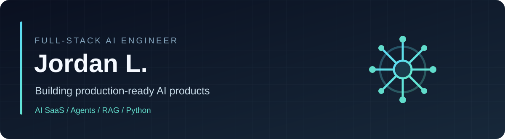
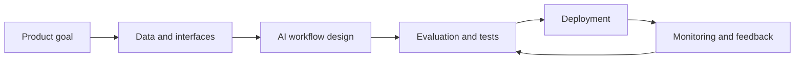

  

  # Hi, I'm Jordan L. 👋
  **Full-Stack AI Engineer · AI SaaS Development · AI Agents · RAG · Python**

  I help founders and product teams turn promising AI ideas and unstable MVPs into reliable, production-oriented software.

  [**View my Upwork profile**](https://www.upwork.com/freelancers/~015a7fbd52d076cab5) · [**Explore code examples**](#engineering-examples) · [**Selected portfolio**](#selected-portfolio)

---

### What I build

- **Full-stack AI products:** multi-tenant SaaS platforms, APIs, dashboards, authentication, integrations and cloud-ready backends.
- **Agentic workflows:** tool calling, multi-step orchestration, human approval, state management and failure handling.
- **RAG and knowledge systems:** document ingestion, retrieval, grounded responses, citations and evaluation.
- **Document AI:** structured extraction, validation and business workflow automation.
- **Production AI engineering:** reliability, latency, observability, cost controls, security and maintainable code.

### Engineering toolkit

| Area | Tools & technologies |
|---|---|
| AI & LLMs | OpenAI API, Claude, Gemini, LangChain, LangGraph, RAG, embeddings, vector databases |
| Backend | Python, FastAPI, REST APIs, third-party integrations |
| Frontend | React, Next.js |
| Data | PostgreSQL, Supabase |
| Delivery | Docker, cloud deployment, monitoring, testing |

### Selected portfolio

These projects are included in my [Upwork portfolio](https://www.upwork.com/freelancers/~015a7fbd52d076cab5). Client application source code is not published here.

| Project | Focus |
|---|---|
| **Constil** | AI-powered construction estimation SaaS |
| **AutoCOI** | AI document processing and certificate-of-insurance compliance workflows |
| **ParkClear** | AI-assisted parking sign scanner for iOS and Android |
| **The Ball Park** | AI construction cost estimation platform |
| **Provista AI** | Prostate MRI analysis and medical imaging platform |
| **OnSpot** | Sports court booking and reservation mobile app |

### Engineering examples

Small, original, self-contained code examples illustrating the engineering practices I prioritize. **These are reference demos, not the proprietary source code of the client projects above.**

| Example | Description |
|---|---|
| **[RAG Evaluation Starter](examples/rag-evaluation-starter/)** | A deterministic retrieval baseline with document ranking, relevance labels, precision@k, recall@k and MRR. Includes tests and a runnable evaluation CLI. Not a production LLM service. |
| **[Human Approval Workflow](examples/human-approval-workflow/)** | A Python state machine showing draft → review → approval → simulated publish, with audit entries, guardrails and idempotency. |

### How I approach production AI

Reliable AI needs more than a model call: clear success criteria, robust integrations, guardrails, human oversight where appropriate, and a way to measure the system after release.

### Let's build something useful

Working on an AI SaaS product, RAG application, or agentic workflow? Tell me what you're building, what's already working, and where production reliability becomes difficult.

**[Contact me on Upwork](https://www.upwork.com/freelancers/~015a7fbd52d076cab5)**
