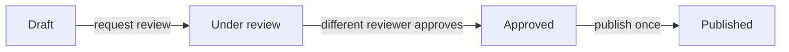

# Human Approval Workflow

A dependency-free Python demonstration of **approval-gated tool execution**, a common building block for agentic systems. The example models content publication but deliberately **does not connect to social platforms or perform real-world writes**.

## Pattern



The example includes explicit state transitions, separation of creator and approver, an in-memory audit trail, and idempotent simulated publication. These are illustrative software controls, **not** a complete production authorization/security implementation.

## Run

```bash
python3 workflow.py
python3 -m unittest discover -s tests -v
```

## Extend this in real systems

Use authenticated identities rather than strings, durable transactional storage, permission checks, audit retention, retries and outbox patterns for actual tools. Add LLM output validation and an explicit approval interface before allowing any consequential action.

**Note:** Original learning/demo code — not extracted from any client project.
